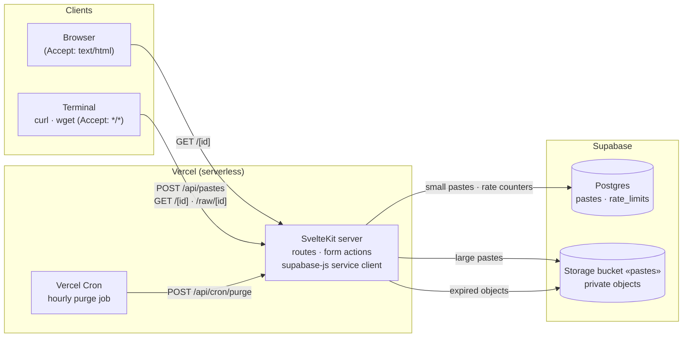
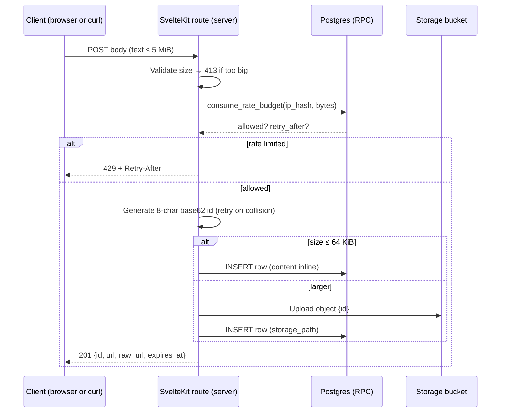
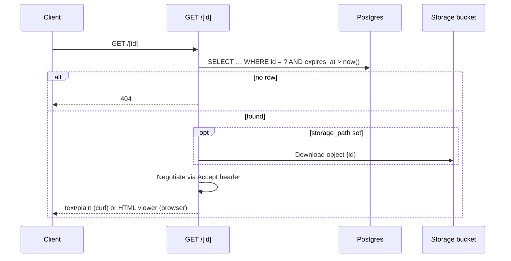

# Architecture

## Overview

`paste` is a stateless SvelteKit application. All persistence is delegated to
Supabase (Postgres + object storage); all hosting runs on Vercel's serverless
platform. There are no user accounts — every capability works identically for a
browser session and a one-line `curl` command.

### Goals

1. **Terminal-first ergonomics** — creating and reading pastes must work from `curl` with zero setup.
2. **Anonymous by default** — no registration, no tracking beyond hashed-IP abuse controls.
3. **Cheap to run** — serverless functions + free-tier-friendly Supabase usage.
4. **Boring to operate** — managed services only; no servers to patch.

## Stack

| Layer | Choice | Notes |
| --- | --- | --- |
| Framework | SvelteKit 2 / Svelte 5 (runes mode) | SSR-first; minimal client JS |
| Runtime (dev/build) | Bun >= 1.4 | Enforced via `engines` + `preinstall` guard |
| Hosting | Vercel | Via `@sveltejs/adapter-vercel` ([ADR 0006](adr/0006-vercel-deployment.md)) |
| Database | Supabase Postgres | Accessed over HTTPS with `@supabase/supabase-js` |
| Object storage | Supabase Storage | Private bucket for large pastes |
| DB access pattern | Typed supabase-js client, service role, server-only | No ORM — see [Database](database.md) |

> **Pending change:** the project currently builds with
> `@sveltejs/adapter-node`. The swap to `adapter-vercel` happens as part of the
> deployment work — see [Deployment § Adapter switch](deployment.md#step-0-adapter-switch).

## Components



The browser never talks to Supabase directly: the `service_role` key exists only
in server-side environment variables, so all reads/writes flow through our own
routes. This keeps the attack surface at the application boundary where size,
rate and expiry checks run.

## Request flows

### Creating a paste



### Reading a paste



Expiry is enforced **at read time** (the query filters `expires_at`), so an
expired paste returns `404` immediately even before the hourly cleanup job
deletes it. Expired and never-existed IDs are indistinguishable by design —
see [Security](security.md).

## Hybrid storage strategy

Pastes are split between Postgres and Storage by size:

| Paste size | Stored | Why |
| --- | --- | --- |
| ≤ 64 KiB | Inline in `pastes.content` (TEXT) | Single read path, no extra network hop, TOAST handles compression |
| > 64 KiB – 5 MiB | Object in private bucket `pastes`, path `{id}` | Avoids bloating table/index pages and backups with large blobs |
| > 5 MiB | Rejected with `413` | Hard cap keeps requests within serverless limits and contains abuse |

Rationale and alternatives: [ADR 0005](adr/0005-hybrid-storage-threshold.md).
A CHECK constraint guarantees each row has exactly one payload source.
Object contents are served exclusively through `/raw/[id]` and `/[id]` — the
bucket stays private, so there is no direct-to-storage hotlinking.

## Paste IDs

- 8 characters, base62 (`A-Za-z0-9`), generated with a CSPRNG (`nanoid`).
- ≈ 48 bits of entropy — enough to make enumeration impractical for this scale;
  collisions retried up to 5 times before failing the request.
- The ID *is* the secret: anyone holding the URL can read the paste. Treat
  paste URLs like bearer tokens (see [Security](security.md)).

## Expiry lifecycle

| Stage | Behaviour |
| --- | --- |
| Creation | Caller picks TTL: `1d`, `7d` *(default)*, `30d`, `90d`, `365d` |
| Read after expiry | Query filters `expires_at` → `404` |
| Cleanup (hourly cron) | `POST /api/cron/purge` deletes expired rows **and** their storage objects |
| Retention | Nothing survives its TTL; DB rows and objects are both removed |

See [Deployment § Scheduled cleanup](deployment.md#scheduled-cleanup).

## Configuration constants

All tunables live in one place and are overridable per environment
([Development § Environment variables](development.md#environment-variables)):

| Constant | Default | Purpose |
| --- | --- | --- |
| `PASTE_INLINE_THRESHOLD_BYTES` | `65536` (64 KiB) | Inline-vs-storage cutoff |
| `PASTE_MAX_BYTES` | `5242880` (5 MiB) | Absolute size cap |
| `RATE_LIMIT_BUDGET_BYTES` | `20971520` (20 MiB/h/IP) | Upload byte budget |
| `RATE_LIMIT_WINDOW_SECONDS` | `3600` | Rate window length |
| TTL options | `1d/7d/30d/90d/365d` | Selectable at creation |

## Intended code layout

```
src/
  lib/
    server/
      supabase.ts      # singleton service-role client (server-only)
      ids.ts           # base62 ID generation
      pastes.ts        # create/read logic incl. hybrid storage
      rate-limit.ts    # budget consumption wrapper around RPC
      config.ts        # constants + env parsing
    types/
      database.ts      # generated Supabase types (see database.md)
  routes/
    +page.svelte       # create UI (+ form action in +page.server.ts)
    api/pastes/+server.ts     # programmatic create endpoint
    [id]/+page.server.ts      # negotiated view (HTML or raw)
    raw/[id]/+server.ts       # forced-raw endpoint
    api/cron/purge/+server.ts # protected cleanup endpoint
supabase/
  migrations/*.sql     # versioned schema changes
```

Server-only modules must stay under `$lib/server` so SvelteKit's import
boundary blocks accidental client bundles — see
[Security § Secrets handling](security.md#secrets-handling).
